# AIoT HW2 — Multiple Linear Regression and Feature Selection: Student Performance, Appliances Energy and Car Price Prediction

## 摘要

本研究以三個真實資料問題實作 Multiple Linear Regression、Baseline 與五種 Feature Selection，
採 training-only nested CV、獨立 holdout、五假設診斷、95% 區間與三題靜態互動儀表板。
全部表格／圖檔來自實際 FAST 產物，沒有虛構結果。
三題樣本與切分不同；RMSE 目標單位是 grade、Wh 與 USD，不能直接比較大小判定哪題模型較好。

## 緒論與問題定義

作業使用 14–39 個原始輸入，研究特徵選擇對泛化、可解釋性與回歸假設的影響。
以下依六階段 CRISP-DM 組織。

| 題目 | 樣本 | CSV 欄位 | 原始輸入 | 完整編碼 | 目標 | 單位 | Train / test |
| --- | --- | --- | --- | --- | --- | --- | --- |
| 學生表現 | 395 | 33 | 30 | 56 | G3 | grade (0-20) | 316 / 79 |
| 家電能源 | 19735 | 29 | 25 | 25 | Appliances | Wh | 15788 / 3947 |
| 汽車價格 | 205 | 26 | 24 | 73 | price | USD | 164 / 41 |

## 資料來源與版本誠實性

指定學生 Kaggle archive 實際只有 Portuguese（649 筆），沒有將其改名為 Mathematics。
本專案改以已記錄來源的 UCI student-mat.csv，395 筆、33 欄：32 個非目標欄位再排除 G1/G2，得到 early-30。
能源為 Kaggle 真實副本，29 欄排除目標、日期與兩個隨機欄後得到 25 個輸入。汽車使用 hellbuoy Kaggle 真實檔，205 筆、26 欄，排除 ID／目標後保留 24 個原始候選欄位。
因此交付是三個真實驗證資料集，但不宣稱三個原檔都來自指定 Kaggle；此來源差異仍需教師接受。

## Multiple Linear Regression 與五種特徵選擇

最終 y=intercept+Xβ，以最小平方法擬合；LASSO 只用來選 support，不是最終 predictor。
Correlation 按 training 絕對 Pearson 排名；Mutual Information 估計互資訊，二元 indicator 視為 discrete；
RFE 沿標準化線性係數遞迴消除；RFECV 以完整 raw-input Pipeline CV 選 RFE 路徑上的 k，可能與 tuned RFE 相同；
LASSO 選非零 support，再以 LinearRegression 擬合。空 support 有明示的一欄 fallback。

FAST inner/outer 各 2 folds，k=1/5/10/20/all（依實際可行寬度），alpha fractions=0.01/0.1。
FULL inner=4、outer=5，探索全部可行 k 與五個 alpha fractions；本次沒有執行 FULL，不以 FAST 宣稱等價統計證據。
最多兩個 joblib workers，每個 native thread=1，outer loops 不再平行，cache 僅重用同一 training fold 的相同計算。

MAE 是平均絕對誤差；MSE 是平方誤差平均；RMSE 為 MSE 平方根、保留目標單位；R² 可為負。
Adjusted R² = 1−[SSE/(n−rank)]/[SST/(n−1)]，rank 為含截距的有效設計維度。

## 實際模型比較

| 題目 | 方法 | encoded k | Inner CV RMSE | CV std | Test RMSE | Test R² |
| --- | --- | --- | --- | --- | --- | --- |
| 學生表現 | Correlation | 1 | 4.2798 | 0.0346 | 4.3446 | 0.0795 |
| 學生表現 | RFE | 1 | 4.2798 | 0.0346 | 4.3446 | 0.0795 |
| 學生表現 | RFECV | 1 | 4.2798 | 0.0346 | 4.3446 | 0.0795 |
| 學生表現 | Mutual Information | 10 | 4.3164 | 0.0908 | 4.3185 | 0.0905 |
| 學生表現 | LASSO | 3 | 4.6109 | 0.0384 | 4.3107 | 0.0938 |
| 學生表現 | Baseline | 56 | 4.7876 | 0.0924 | 4.1957 | 0.1415 |
| 家電能源 | Mutual Information | 10 | 96.0286 | 1.0752 | 93.1965 | -0.0480 |
| 家電能源 | RFE | 10 | 98.2936 | 1.6599 | 87.0556 | 0.0856 |
| 家電能源 | RFECV | 10 | 98.2936 | 1.6599 | 87.0556 | 0.0856 |
| 家電能源 | Correlation | 5 | 98.4382 | 0.0480 | 94.7469 | -0.0831 |
| 家電能源 | LASSO | 4 | 99.2578 | 0.6517 | 94.7312 | -0.0828 |
| 家電能源 | Baseline | 25 | 100.4710 | 2.8834 | 86.7329 | 0.0924 |
| 汽車價格 | LASSO | 38 | 3183.2454 | 618.5981 | 2869.8225 | 0.8957 |
| 汽車價格 | Correlation | 5 | 3445.7923 | 519.8880 | 3816.5329 | 0.8155 |
| 汽車價格 | Mutual Information | 5 | 3524.7610 | 447.8558 | 3811.5904 | 0.8160 |
| 汽車價格 | RFE | 5 | 3755.7107 | 561.0313 | 3093.6381 | 0.8788 |
| 汽車價格 | RFECV | 5 | 3755.7107 | 561.0313 | 3093.6381 | 0.8788 |
| 汽車價格 | Baseline | 73 | 6091.5086 | 3265.8509 | 2794.4080 | 0.9011 |

CV std 是 fold RMSE 的標準差，不是平均的標準誤或信賴區間。推薦僅依 training inner CV，不依 test。
下面各題另列完整 train/test 指標。

## 實際執行時間

| 題目 | Pipeline 秒 | 診斷／圖表秒 | 上述合計秒 | cache namespace 已存在 |
| --- | --- | --- | --- | --- |
| 學生表現 | 15.58 | 7.67 | 23.25 | False |
| 家電能源 | 19.18 | 10.60 | 29.77 | False |
| 汽車價格 | 10.15 | 12.32 | 22.47 | True |

Pipeline 時間含載入、nested/final CV、評估及模型／CSV 匯出，不含 Python 匯入與程序啟閉；可能含 cache hit。
診斷時間含指標、區間、檢定與 13 張圖。上述合計不含共用 dashboard export、browser QA 與文件產生；
共用步驟 wall time 另見驗收紀錄，不任意分攤到單題。

## 學生表現：六階段 CRISP-DM

### 1. Business Understanding — 業務理解

以背景、家庭、學習與出缺席資料預測數學 G3，供學習支持研究使用；不是因果評估或個人處分工具。G1/G2 是歷史學期成績，取得後是另一個較晚期情境，正式 early-30 沒有使用。

### 2. Data Understanding — 資料理解

實際 395 筆、33 個 CSV 欄位、30 個原始輸入，包含 13 數值／17 類別。
目標範圍 0.00–20.00，平均 10.4152，樣本標準差 4.5814。
輸入缺失儲存格 0 個。沒有缺值也保留可重用的 fold-local imputer。

原始 CSV：school, sex, age, address, famsize, Pstatus, Medu, Fedu, Mjob, Fjob, reason, guardian, traveltime, studytime, failures, schoolsup, famsup, paid, activities, nursery, higher, internet, romantic, famrel, freetime, goout, Dalc, Walc, health, absences, G1, G2, G3。

正式輸入：school, sex, age, address, famsize, Pstatus, Medu, Fedu, Mjob, Fjob, reason, guardian, traveltime, studytime, failures, schoolsup, famsup, paid, activities, nursery, higher, internet, romantic, famrel, freetime, goout, Dalc, Walc, health, absences。

資料 SHA-256：e47f9ee225e1ee6e69b7564e6dac7123e80b8486677fe111f351964cef5dec80。

### 3. Data Preparation — 資料準備

排除 G3/G1/G2。seed=42，316/79 的 shuffled 80/20 holdout，inner/outer 為 shuffled KFold。
數值中位數補值與 StandardScaler；學生名目類別使用眾數補值與 OneHotEncoder(handle_unknown="ignore")。
全部處理、排名與選擇放在完整 Pipeline，由每個 training fold 擬合，不能先全資料 fit 再 CV。
來源索引保留，能源不排序、不回填未來觀測；非法 schema、數值、目標或時間戳明確拒絕。

### 4. Modeling — 建模

Baseline 與五種方法最終都使用 LinearRegression。FAST 的 inner=2、outer=2。
內層選 k／alpha；外層評估完整訓練期選擇流程；全訓練部分再依 inner CV 固定正式方法，最後才評估 test。
推薦 **Correlation**，1 個 encoded 特徵，代表 1 個原始欄位；完整訓練編碼寬度 56。

選中特徵：numeric__failures。

Inner CV RMSE=4.279815 ± 0.034630；
該方法 outer nested RMSE=4.274467 ± 0.039979；
包含方法選擇的 workflow nested RMSE=4.274467 ± 0.039979。
三者不是同一統計量；inner tuning score 不能冒充獨立泛化保證。

### 5. Evaluation — 評估

| 方法 | 資料 | encoded k | 有效 rank | MAE | MSE | RMSE | R² | Adjusted R² |
| --- | --- | --- | --- | --- | --- | --- | --- | --- |
| Correlation | train | 1 | 2 | 3.1957 | 18.0701 | 4.2509 | 0.1397 | 0.1370 |
| Correlation | test | 1 | 2 | 3.4755 | 18.8756 | 4.3446 | 0.0795 | 0.0675 |
| RFE | train | 1 | 2 | 3.1957 | 18.0701 | 4.2509 | 0.1397 | 0.1370 |
| RFE | test | 1 | 2 | 3.4755 | 18.8756 | 4.3446 | 0.0795 | 0.0675 |
| RFECV | train | 1 | 2 | 3.1957 | 18.0701 | 4.2509 | 0.1397 | 0.1370 |
| RFECV | test | 1 | 2 | 3.4755 | 18.8756 | 4.3446 | 0.0795 | 0.0675 |
| Mutual Information | train | 10 | 10 | 3.1419 | 17.2307 | 4.1510 | 0.1797 | 0.1555 |
| Mutual Information | test | 10 | 10 | 3.4270 | 18.6493 | 4.3185 | 0.0905 | -0.0281 |
| LASSO | train | 3 | 4 | 3.1825 | 17.5601 | 4.1905 | 0.1640 | 0.1559 |
| LASSO | test | 3 | 4 | 3.4442 | 18.5820 | 4.3107 | 0.0938 | 0.0575 |
| Baseline | train | 56 | 40 | 2.9462 | 14.9390 | 3.8651 | 0.2888 | 0.1883 |
| Baseline | test | 56 | 40 | 3.3953 | 17.6037 | 4.1957 | 0.1415 | -0.7170 |

Adjusted R² 使用 training affine design rank（含截距）；test 值只是描述性懲罰，不是重新擬合測試資料的推論。
自由度不足或常數目標時為空值。以下五項證據不代表因果，也不能自動宣稱假設全部成立。

#### linearity — Binned residual means vs fitted (descriptive)

以殘差對 fitted 與分箱平均檢查線性。殘差均值跨度 >0.5 個殘差 SD 只是宣告的視覺篩檢，不是顯著性檢定；未觸發不能證明線性。

實際統計：

    {"bin_count": 4, "minimum_bin_mean": -0.6203449271774554, "maximum_bin_mean": 0.9659316175840529, "bin_mean_span_residual_sd": 0.37316281817171826}

原始診斷解讀：Bin-mean residual span is 0.373 residual SD; inspect the plotted trend.

限制：A span >0.5 SD is a declared visual screening heuristic, not a significance test. A small span does not establish linearity.

#### independence — Durbin-Watson (source row order; descriptive only)

學生來源行序不是時間，DW 只能描述該順序，不足以證實獨立；學校／群組相依仍可能存在。

實際統計：

    {"durbin_watson": 2.0609976507858803, "ljung_box": [], "acf": [1.0, -0.03317304641593798, 0.09943699310318997, 0.040711832200441465, 0.03834037996382661, -0.018626996889129815, -0.011453374019408437, -0.01376826241010809, 0.000337159950508455, -0.04478323565788367, 0.13806528504827748, 0.02694474066752129, 0.06692477683704401, -0.04577440195001156, 0.016010710341280474, -0.07552951977614393, -0.0586955942311896, 0.028521388926540606, -0.05318841059347129, 0.008496802112928215, -0.12297561364419582, 0.04859998961001764, 0.016813860129001434, -0.016226091460569934, 0.04242259514333774, -0.058343933104388034, -0.049444456597701664, 0.03855454718067217, -0.02786701654400665, 0.035856120660640284, -0.10411152120240053, -0.002444596401547679, -0.055459215967823765, 0.023125622281074773, 0.01859397617844038, 0.047717065406820386, -0.02581494758156902, 0.048169907469387235, -0.007443233841439827, -0.012795487021412418, 0.0016421414156652075]}

原始診斷解讀：DW=2.0610; lag-1 ACF=-0.0332.

限制：These observations have no justified temporal sampling order. DW cannot establish independence; group dependence remains possible.

#### homoscedasticity — Koenker-Breusch-Pagan on full-rank equivalent design

Koenker-Breusch-Pagan 未拒絕等變異，但不等於證明等變異；選擇程序影響 nominal p-value。

實際統計：

    {"lm_statistic": 1.4912342149644262, "lm_pvalue": 0.22202506313944598, "f_statistic": 1.4888219167120704, "f_pvalue": 0.22331492369010295, "auxiliary_df": 1}

原始診斷解讀：LM=1.4912, p=0.222; constant variance not rejected.

限制：Rank-reduced auxiliary design includes an intercept. Nonrejection is not proof; temporal dependence and selection can invalidate nominal p-values.

#### normality — Shapiro-Wilk

實際常態性檢定拒絕常態。學生與汽車採 Shapiro-Wilk，能源大樣本採 Jarque-Bera；大樣本可對小偏離很敏感，必須同看 Q-Q、直方圖、偏態及尾部。

實際統計：

    {"test": "Shapiro-Wilk", "statistic": 0.9490413186313874, "pvalue": 5.315358045554703e-09, "pvalue_underflow": false, "n": 316, "skewness": -0.7246179542913617, "pearson_kurtosis": 3.637398712329716}

原始診斷解讀：p=5.32e-09, skew=-0.725, kurtosis=3.637; normality rejected.

限制：Shapiro p-values are not used beyond 5000 observations. Large-sample tests detect small departures; fitted/selected and serially dependent residuals are not iid raw samples. Inspect histogram and Q-Q.

#### multicollinearity — Design rank, condition number and VIF (intercept excluded)

檢查含截距的 affine rank、VIF 與 condition。完整 one-hot 可造成 aliasing；個別不可識別係數不提供虛假的 SE/CI，不能只把原始特徵數當模型維度。

實際統計：

    {"rank": 2, "columns_with_intercept": 2, "condition_number": 1.0000000000000007, "effective_centered_condition": 1.0, "perfectly_collinear_columns": 0, "vif_above_10": 0}

原始診斷解讀：Design rank 2/2; 0 perfectly collinear columns; 0 finite VIF values above 10.

限制：VIF >10 is a screening convention, not a universal cutoff. Full one-hot sets create exact aliasing; null VIF plus status denotes infinity/undefined, not zero. Individual aliased coefficients are not unique.

#### 信賴區間、預測區間與實際殘差分析

條件平均 mean CI 描述 E[Y|X]；個別觀測 PI 加入殘差變異，通常更寬。
使用同一已選定 sklearn 模型的設計與係數順序，透過 centered SVD 的等價滿秩基底與 statsmodels OLS 計算 t 區間。
學生與汽車另有 HC3、能源有 HAC（24 lag）漸近 mean CI；robust mean CI 不是 robust individual PI。
超出訓練 affine span 時不輸出可識別區間；不強行反轉奇異矩陣。
沒有校正特徵／方法選擇不確定性，沒有證實 nominal coverage；不任意裁切負 Wh 或超過 0–20 的區間。

實際區間 metadata：

    {"level": 0.95, "training_rank": 2, "residual_df": 314, "classical_label": "Approximate post-selection OLS t mean CI / individual PI; iid homoscedastic normal-error working model", "robust_mean_covariance": "HC3", "hac_maxlags": null, "limitations": "Pointwise, conditional on selected features; excludes feature/method-selection uncertainty. Classical PI is not heteroscedasticity/autocorrelation-robust. Robust mean CI does not provide an individual PI or forecast guarantee. No clipping to physical target bounds.", "maximum_mean_prediction_difference": 9.769962616701378e-15, "robust_mean_status": "asymptotic_approximation", "status": "estimated", "nonestimable_rows": 0}

測試 R² 約 0.0795，顯示 early-30 預測訊號有限；Baseline 測試 RMSE 較低，仍不據此重選方法。

### 6. Deployment — 部署

既有靜態 DataLab 讀取 Python 真實產出的 schema-5 descriptor、係數、covariance、指標與殘差。
瀏覽器重現訓練補值、縮放、one-hot 和精確欄序，並逐筆與 Python 核對。
保留三題／方法／k 切換、預測、情境、CSV、深色與手機版；切題清除情境，不混合資料。
本機與 nested HTTP path 通過不等於公開 GitHub Pages 已更新；公開部署狀態以實際驗證為準。

### 本題實際圖表

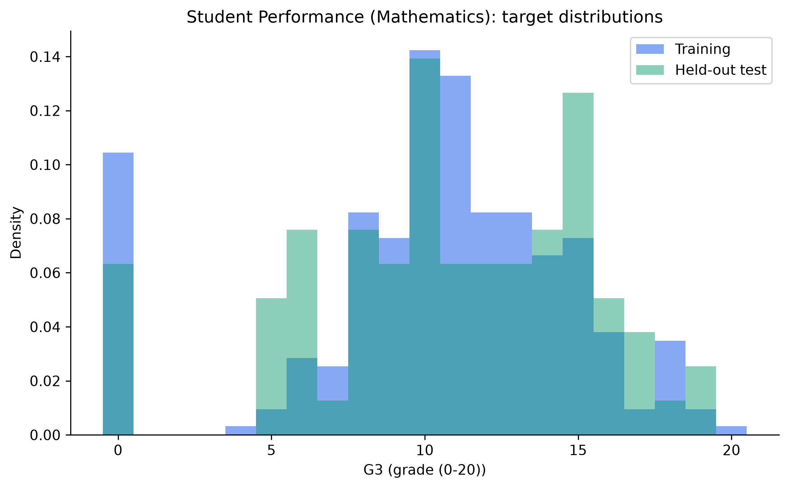

圖 1：學生表現，訓練／測試目標分布；實際 FAST 產物，300 dpi。
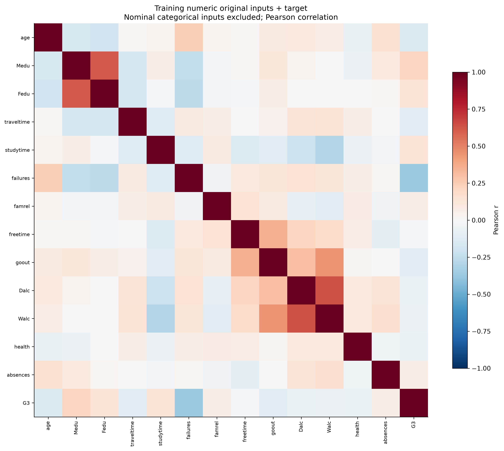

圖 2：學生表現，訓練原始數值特徵相關矩陣；實際 FAST 產物，300 dpi。
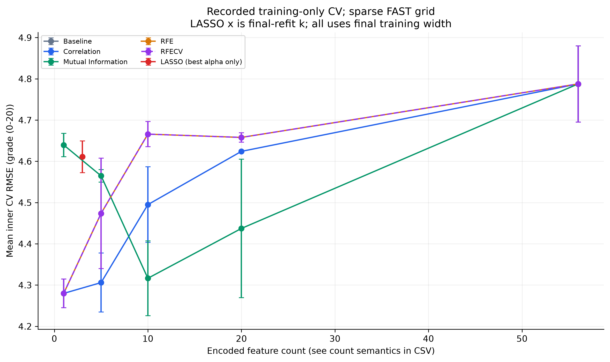

圖 3：學生表現，特徵數與 inner CV RMSE；實際 FAST 產物，300 dpi。
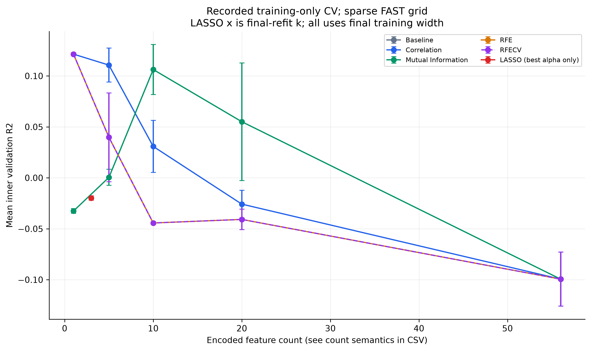

圖 4：學生表現，特徵數與 inner validation R²；實際 FAST 產物，300 dpi。
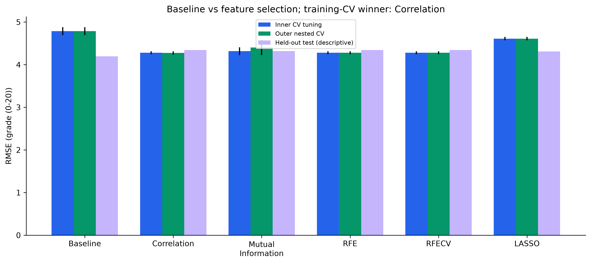

圖 5：學生表現，Baseline 與特徵選擇 RMSE 比較；實際 FAST 產物，300 dpi。
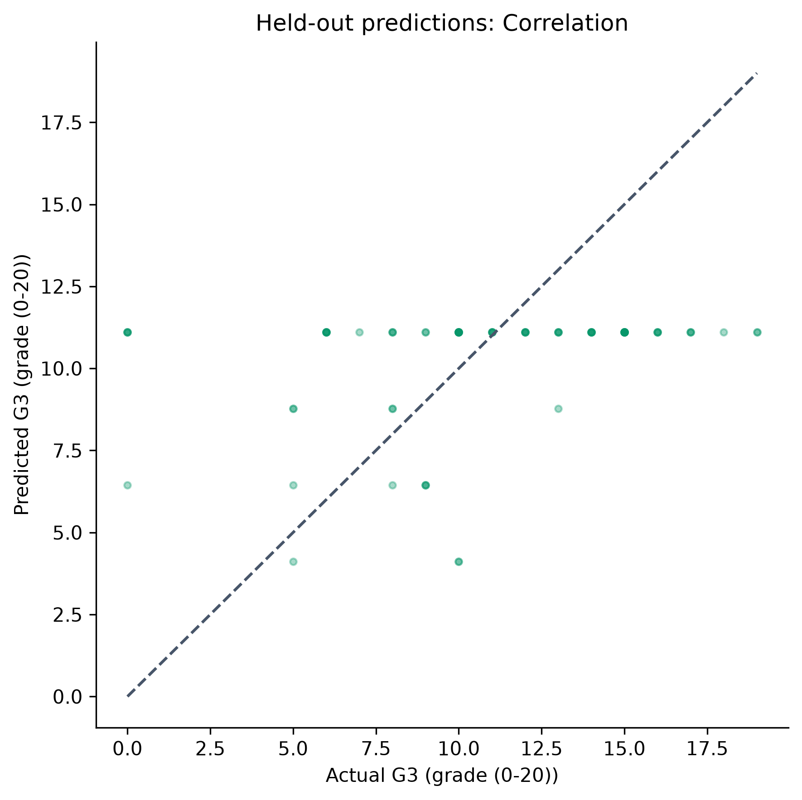

圖 6：學生表現，測試實際值對預測值；實際 FAST 產物，300 dpi。
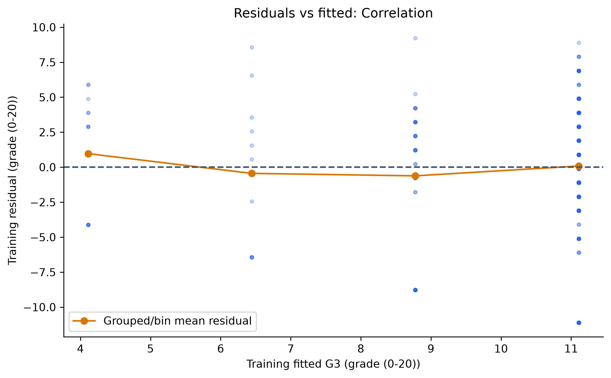

圖 7：學生表現，訓練殘差對擬合值；實際 FAST 產物，300 dpi。
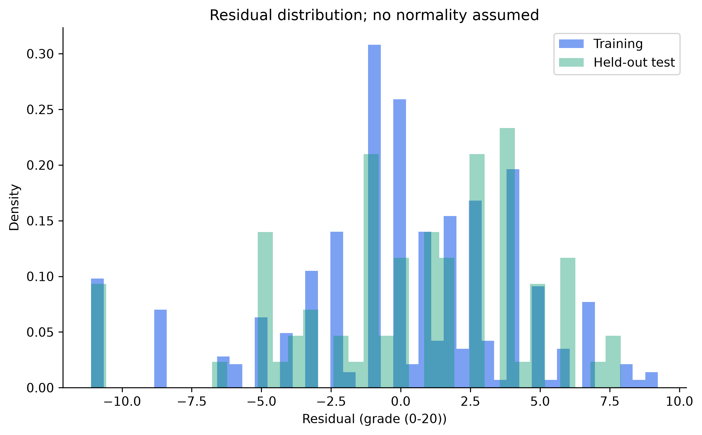

圖 8：學生表現，訓練／測試殘差直方圖；實際 FAST 產物，300 dpi。
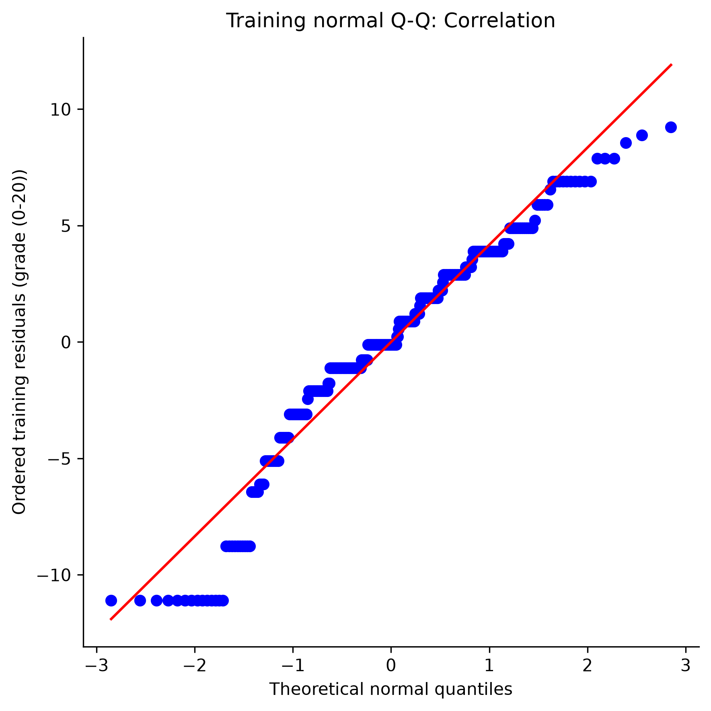

圖 9：學生表現，訓練殘差常態 Q-Q 圖；實際 FAST 產物，300 dpi。
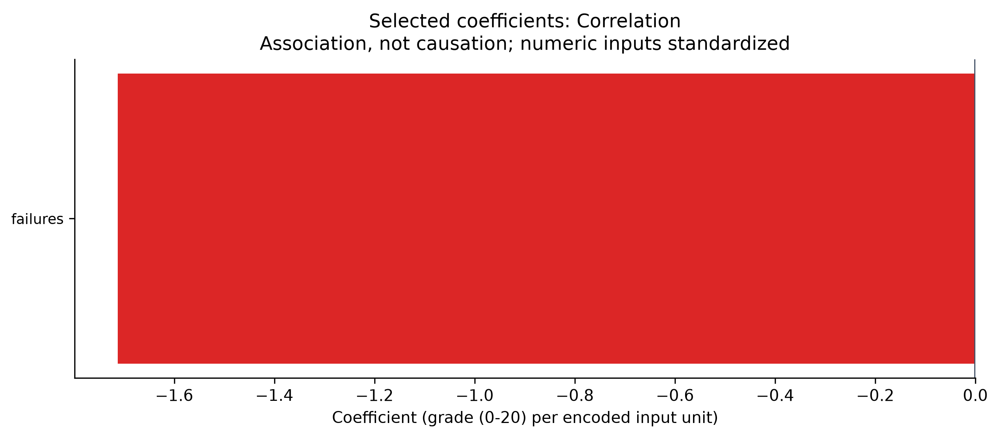

圖 10：學生表現，選定模型係數；實際 FAST 產物，300 dpi。
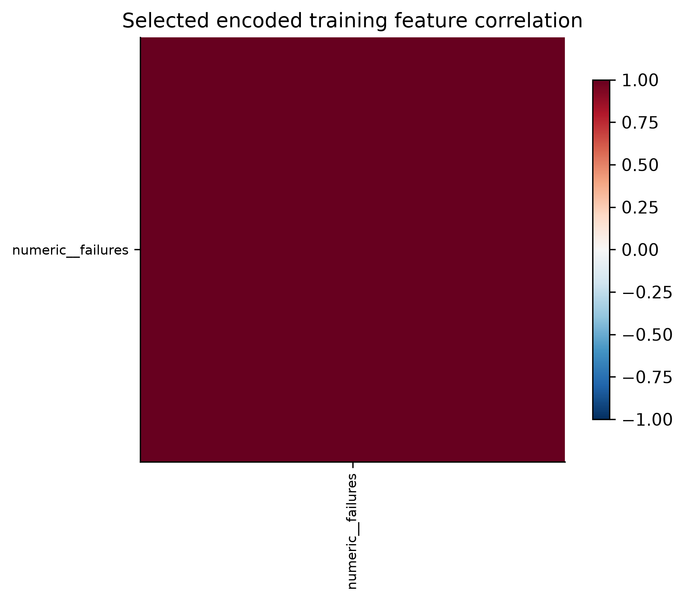

圖 11：學生表現，選定編碼特徵相關矩陣；實際 FAST 產物，300 dpi。
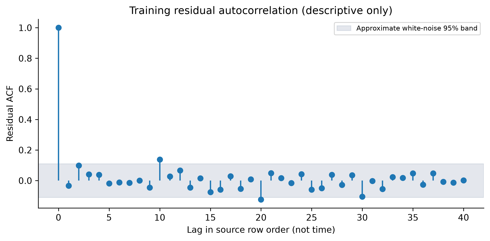

圖 12：學生表現，訓練殘差自相關；實際 FAST 產物，300 dpi。
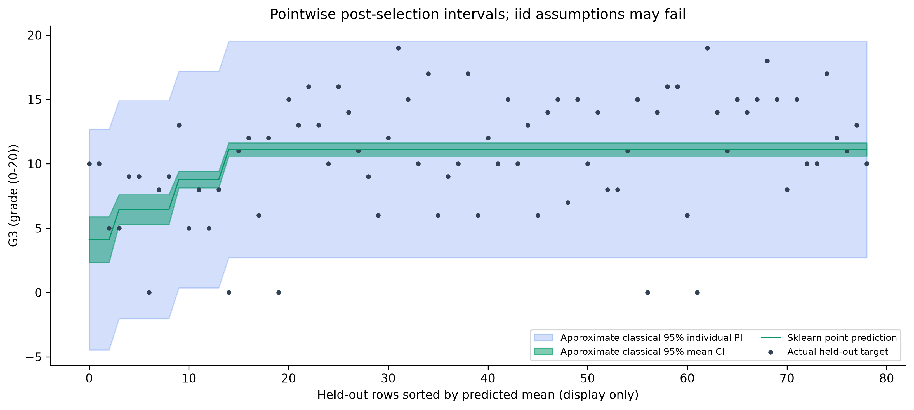

圖 13：學生表現，測試平均信賴區間與個別預測區間；實際 FAST 產物，300 dpi。

## 家電能源：六階段 CRISP-DM

### 1. Business Understanding — 業務理解

由住宅同期感測及氣象估計 Appliances（Wh），探討節能估計的可行性。保留 lights；同期估計不代表可事先取得所有輸入的未來負載預報。

### 2. Data Understanding — 資料理解

實際 19,735 筆、29 個 CSV 欄位、25 個原始輸入，包含 25 數值／0 類別。
目標範圍 10.00–1080.00，平均 97.6950，樣本標準差 102.5249。
輸入缺失儲存格 0 個。沒有缺值也保留可重用的 fold-local imputer。

原始 CSV：date, Appliances, lights, T1, RH_1, T2, RH_2, T3, RH_3, T4, RH_4, T5, RH_5, T6, RH_6, T7, RH_7, T8, RH_8, T9, RH_9, T_out, Press_mm_hg, RH_out, Windspeed, Visibility, Tdewpoint, rv1, rv2。

正式輸入：lights, T1, RH_1, T2, RH_2, T3, RH_3, T4, RH_4, T5, RH_5, T6, RH_6, T7, RH_7, T8, RH_8, T9, RH_9, T_out, Press_mm_hg, RH_out, Windspeed, Visibility, Tdewpoint。

資料 SHA-256：2820bf712ad0275cb18b85a05250926100d8e65ebb9f4d2d016ca91ea152a25d。

### 3. Data Preparation — 資料準備

排除 Appliances、rv1、rv2；date 另存 metadata。前 15,788 筆訓練，後 3,947 筆測試；inner/outer 均為 expanding TimeSeriesSplit，gap=0，不 shuffle。時間從 2016-01-11 17:00:00 至 2016-05-27 18:00:00。
數值中位數補值與 StandardScaler；學生名目類別使用眾數補值與 OneHotEncoder(handle_unknown="ignore")。
全部處理、排名與選擇放在完整 Pipeline，由每個 training fold 擬合，不能先全資料 fit 再 CV。
來源索引保留，能源不排序、不回填未來觀測；非法 schema、數值、目標或時間戳明確拒絕。

### 4. Modeling — 建模

Baseline 與五種方法最終都使用 LinearRegression。FAST 的 inner=2、outer=2。
內層選 k／alpha；外層評估完整訓練期選擇流程；全訓練部分再依 inner CV 固定正式方法，最後才評估 test。
推薦 **Mutual Information**，10 個 encoded 特徵，代表 10 個原始欄位；完整訓練編碼寬度 25。

選中特徵：numeric__T3, numeric__T5, numeric__T8, numeric__T9, numeric__RH_6, numeric__T4, numeric__RH_8, numeric__T7, numeric__Press_mm_hg, numeric__RH_7。

Inner CV RMSE=96.028557 ± 1.075245；
該方法 outer nested RMSE=96.182714 ± 1.229402；
包含方法選擇的 workflow nested RMSE=98.988592 ± 0.598444。
三者不是同一統計量；inner tuning score 不能冒充獨立泛化保證。

### 5. Evaluation — 評估

| 方法 | 資料 | encoded k | 有效 rank | MAE | MSE | RMSE | R² | Adjusted R² |
| --- | --- | --- | --- | --- | --- | --- | --- | --- |
| Mutual Information | train | 10 | 11 | 58.5536 | 10217.1398 | 101.0799 | 0.0767 | 0.0761 |
| Mutual Information | test | 10 | 11 | 52.6493 | 8685.5968 | 93.1965 | -0.0480 | -0.0506 |
| RFE | train | 10 | 11 | 55.1402 | 9264.4489 | 96.2520 | 0.1628 | 0.1623 |
| RFE | test | 10 | 11 | 54.2491 | 7578.6828 | 87.0556 | 0.0856 | 0.0833 |
| RFECV | train | 10 | 11 | 55.1402 | 9264.4489 | 96.2520 | 0.1628 | 0.1623 |
| RFECV | test | 10 | 11 | 54.2491 | 7578.6828 | 87.0556 | 0.0856 | 0.0833 |
| Correlation | train | 5 | 6 | 58.0246 | 10137.8328 | 100.6868 | 0.0839 | 0.0836 |
| Correlation | test | 5 | 6 | 70.0530 | 8976.9766 | 94.7469 | -0.0831 | -0.0845 |
| LASSO | train | 4 | 5 | 58.0294 | 10137.8933 | 100.6871 | 0.0839 | 0.0836 |
| LASSO | test | 4 | 5 | 69.9991 | 8973.9960 | 94.7312 | -0.0828 | -0.0839 |
| Baseline | train | 25 | 26 | 54.2892 | 9152.6874 | 95.6697 | 0.1729 | 0.1716 |
| Baseline | test | 25 | 26 | 52.0141 | 7522.6026 | 86.7329 | 0.0924 | 0.0866 |

Adjusted R² 使用 training affine design rank（含截距）；test 值只是描述性懲罰，不是重新擬合測試資料的推論。
自由度不足或常數目標時為空值。以下五項證據不代表因果，也不能自動宣稱假設全部成立。

#### linearity — Binned residual means vs fitted (descriptive)

以殘差對 fitted 與分箱平均檢查線性。殘差均值跨度 >0.5 個殘差 SD 只是宣告的視覺篩檢，不是顯著性檢定；未觸發不能證明線性。

實際統計：

    {"bin_count": 10, "minimum_bin_mean": -15.028643433999045, "maximum_bin_mean": 21.0414023101207, "bin_mean_span_residual_sd": 0.356846979175533}

原始診斷解讀：Bin-mean residual span is 0.357 residual SD; inspect the plotted trend.

限制：A span >0.5 SD is a declared visual screening heuristic, not a significance test. A small span does not establish linearity.

#### independence — Durbin-Watson and Ljung-Box

能源殘差 DW 約 0.532、lag-1 ACF 約 0.734，顯示強烈正自相關；Ljung-Box 也支持序列相依，p=0 是浮點下溢，不是字面機率為零。

實際統計：

    {"durbin_watson": 0.5318112553387963, "ljung_box": [{"lag": 1, "statistic": 8506.624101437408, "pvalue": 0.0}, {"lag": 6, "statistic": 18254.71906189033, "pvalue": 0.0}, {"lag": 12, "statistic": 23677.116947061302, "pvalue": 0.0}, {"lag": 24, "statistic": 26593.339806248307, "pvalue": 0.0}], "acf": [1.0, 0.7339623824595486, 0.49283212762126755, 0.3765899738587312, 0.3165286021294577, 0.2757461786193054, 0.2372769172411049, 0.20262330568756023, 0.21131867227719442, 0.2482450186725512, 0.26975086058533543, 0.25495394855695175, 0.2410208348303892, 0.22508856095628163, 0.19571688218945865, 0.16257644591553538, 0.13285849237189865, 0.10693947252722676, 0.09437985057182643, 0.09146894817689533, 0.08497808450106349, 0.07245076582678305, 0.06563416514934078, 0.059958338746248036, 0.048679859803456495, 0.03760692755991994, 0.03397138058634001, 0.03535430416528824, 0.03752964739502233, 0.032172636881586, 0.027361285097922745, 0.021694363486283213, 0.01959557522246746, 0.01735322836230981, 0.008865009879680853, 0.002601714232585941, 0.0008711206508173842, 0.0005173422344912971, 0.005899935989631078, 0.009428909724743221, 0.012646631638696273]}

原始診斷解讀：DW=0.5318; lag-1 ACF=0.7340.

限制：Energy residuals retain chronological order; Ljung-Box model_df=0 is exploratory after regression/selection, with multiple correlated lag tests.

#### homoscedasticity — Koenker-Breusch-Pagan on full-rank equivalent design

Koenker-Breusch-Pagan 提供反對等變異的證據；時間相依又限制傳統檢定 p-value 的解釋。

實際統計：

    {"lm_statistic": 179.34747480167664, "lm_pvalue": 3.2005678397010025e-33, "f_statistic": 18.128183104711095, "f_pvalue": 2.035876140963681e-33, "auxiliary_df": 10}

原始診斷解讀：LM=179.3475, p=3.2e-33; evidence against constant variance.

限制：Rank-reduced auxiliary design includes an intercept. Nonrejection is not proof; temporal dependence and selection can invalidate nominal p-values.

#### normality — Jarque-Bera (large-sample)

實際常態性檢定拒絕常態。學生與汽車採 Shapiro-Wilk，能源大樣本採 Jarque-Bera；大樣本可對小偏離很敏感，必須同看 Q-Q、直方圖、偏態及尾部。

實際統計：

    {"test": "Jarque-Bera (large-sample)", "statistic": 156862.81833433363, "pvalue": 0.0, "pvalue_underflow": true, "n": 15788, "skewness": 3.354749971227189, "pearson_kurtosis": 16.913233106326114}

原始診斷解讀：p=below floating-point resolution, skew=3.355, kurtosis=16.913; normality rejected.

限制：Shapiro p-values are not used beyond 5000 observations. Large-sample tests detect small departures; fitted/selected and serially dependent residuals are not iid raw samples. Inspect histogram and Q-Q.

#### multicollinearity — Design rank, condition number and VIF (intercept excluded)

檢查含截距的 affine rank、VIF 與 condition。完整 one-hot 可造成 aliasing；個別不可識別係數不提供虛假的 SE/CI，不能只把原始特徵數當模型維度。

實際統計：

    {"rank": 11, "columns_with_intercept": 11, "condition_number": 9.4764569800211, "effective_centered_condition": 9.476456980021096, "perfectly_collinear_columns": 0, "vif_above_10": 0}

原始診斷解讀：Design rank 11/11; 0 perfectly collinear columns; 0 finite VIF values above 10.

限制：VIF >10 is a screening convention, not a universal cutoff. Full one-hot sets create exact aliasing; null VIF plus status denotes infinity/undefined, not zero. Individual aliased coefficients are not unique.

#### 信賴區間、預測區間與實際殘差分析

條件平均 mean CI 描述 E[Y|X]；個別觀測 PI 加入殘差變異，通常更寬。
使用同一已選定 sklearn 模型的設計與係數順序，透過 centered SVD 的等價滿秩基底與 statsmodels OLS 計算 t 區間。
學生與汽車另有 HC3、能源有 HAC（24 lag）漸近 mean CI；robust mean CI 不是 robust individual PI。
超出訓練 affine span 時不輸出可識別區間；不強行反轉奇異矩陣。
沒有校正特徵／方法選擇不確定性，沒有證實 nominal coverage；不任意裁切負 Wh 或超過 0–20 的區間。

實際區間 metadata：

    {"level": 0.95, "training_rank": 11, "residual_df": 15777, "classical_label": "Approximate post-selection OLS t mean CI / individual PI; iid homoscedastic normal-error working model", "robust_mean_covariance": "HAC", "hac_maxlags": 24, "limitations": "Pointwise, conditional on selected features; excludes feature/method-selection uncertainty. Classical PI is not heteroscedasticity/autocorrelation-robust. Robust mean CI does not provide an individual PI or forecast guarantee. No clipping to physical target bounds.", "maximum_mean_prediction_difference": 3.694822225952521e-13, "robust_mean_status": "asymptotic_approximation", "status": "estimated", "nonestimable_rows": 0}

測試 R² 為負，表示在此測試時段的描述性比較中，SSE 大於以測試目標平均值計算的 SST；不表示已建立可部署的平均值模型。Baseline 測試表現較佳仍不據此改選方法。自相關、右尾與異質變異使傳統 OLS 個別 PI 不宜當作已校準保證。

### 6. Deployment — 部署

既有靜態 DataLab 讀取 Python 真實產出的 schema-5 descriptor、係數、covariance、指標與殘差。
瀏覽器重現訓練補值、縮放、one-hot 和精確欄序，並逐筆與 Python 核對。
保留三題／方法／k 切換、預測、情境、CSV、深色與手機版；切題清除情境，不混合資料。
本機與 nested HTTP path 通過不等於公開 GitHub Pages 已更新；公開部署狀態以實際驗證為準。

### 本題實際圖表

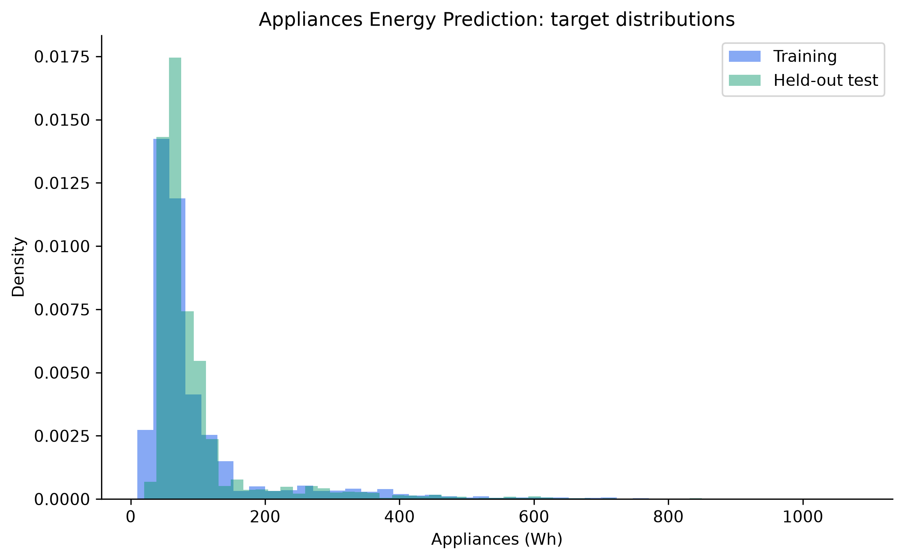

圖 14：家電能源，訓練／測試目標分布；實際 FAST 產物，300 dpi。
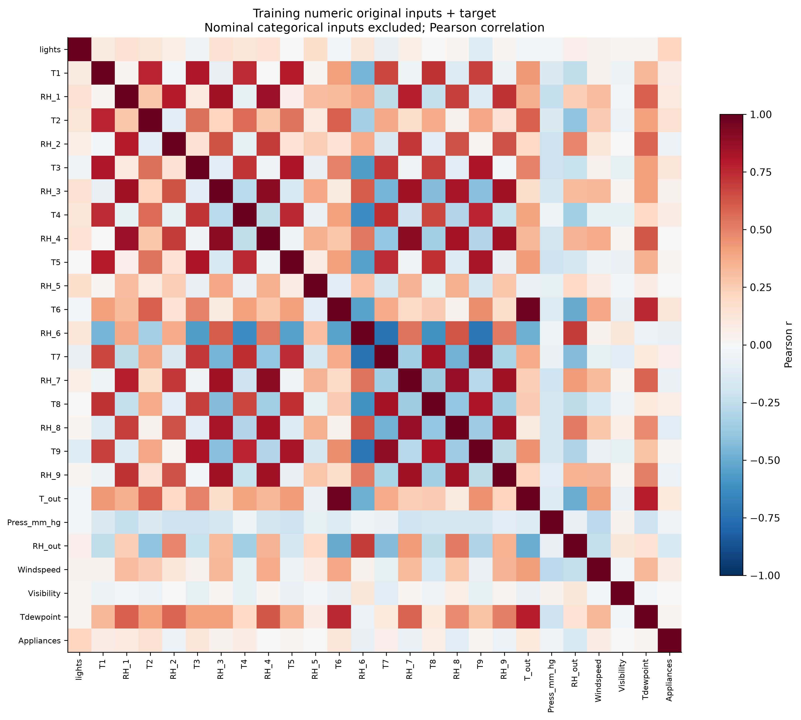

圖 15：家電能源，訓練原始數值特徵相關矩陣；實際 FAST 產物，300 dpi。
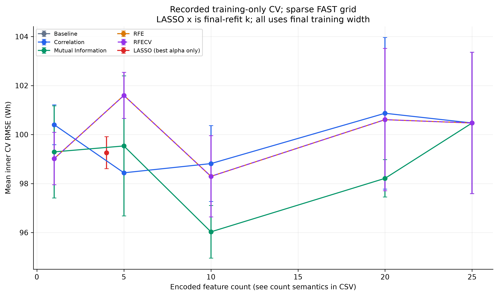

圖 16：家電能源，特徵數與 inner CV RMSE；實際 FAST 產物，300 dpi。
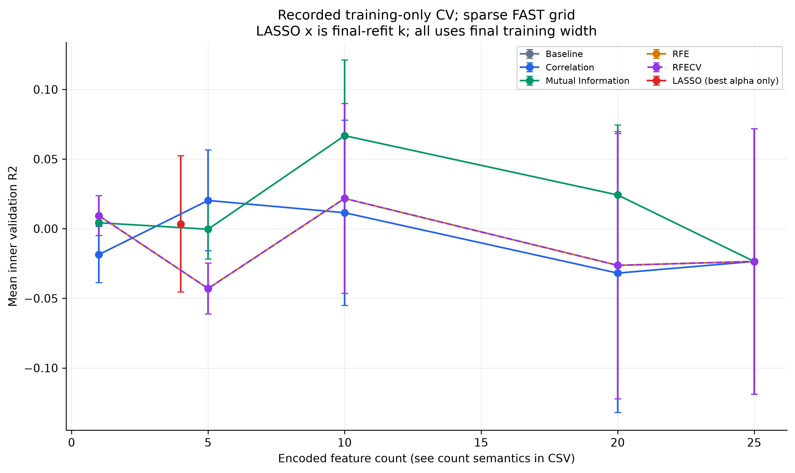

圖 17：家電能源，特徵數與 inner validation R²；實際 FAST 產物，300 dpi。
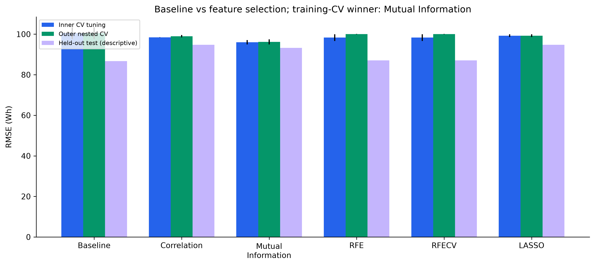

圖 18：家電能源，Baseline 與特徵選擇 RMSE 比較；實際 FAST 產物，300 dpi。
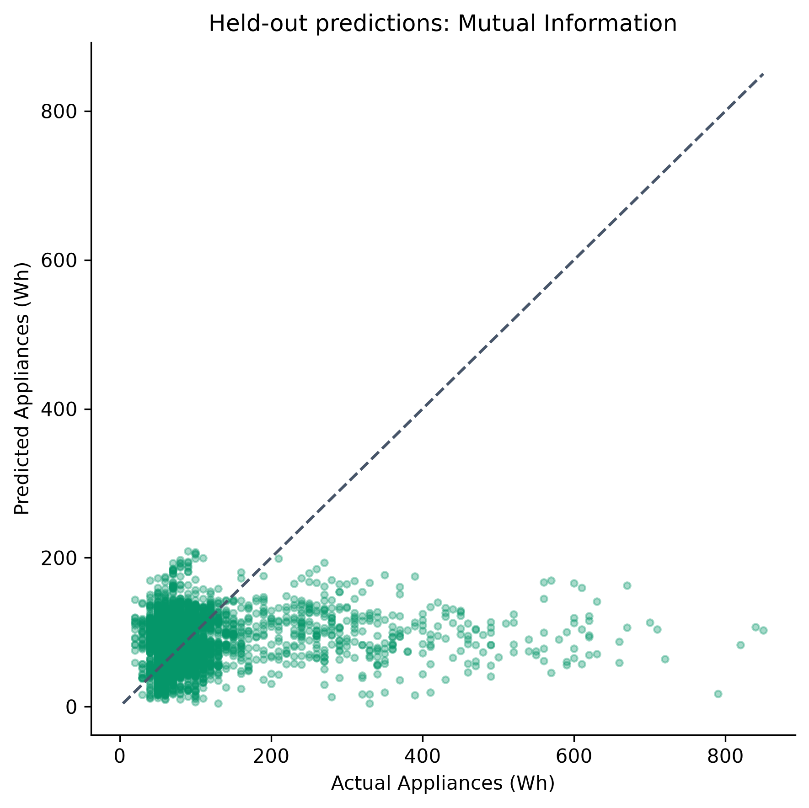

圖 19：家電能源，測試實際值對預測值；實際 FAST 產物，300 dpi。
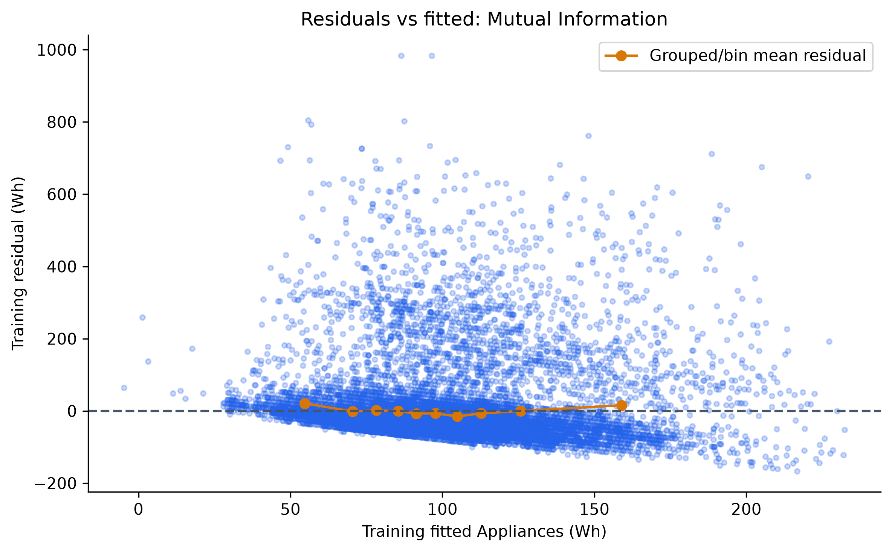

圖 20：家電能源，訓練殘差對擬合值；實際 FAST 產物，300 dpi。
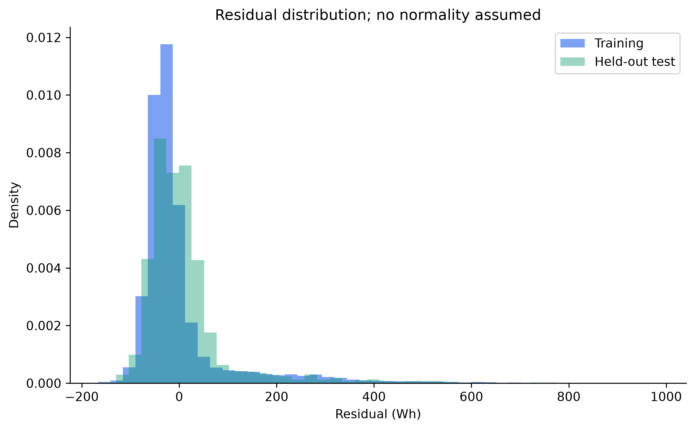

圖 21：家電能源，訓練／測試殘差直方圖；實際 FAST 產物，300 dpi。
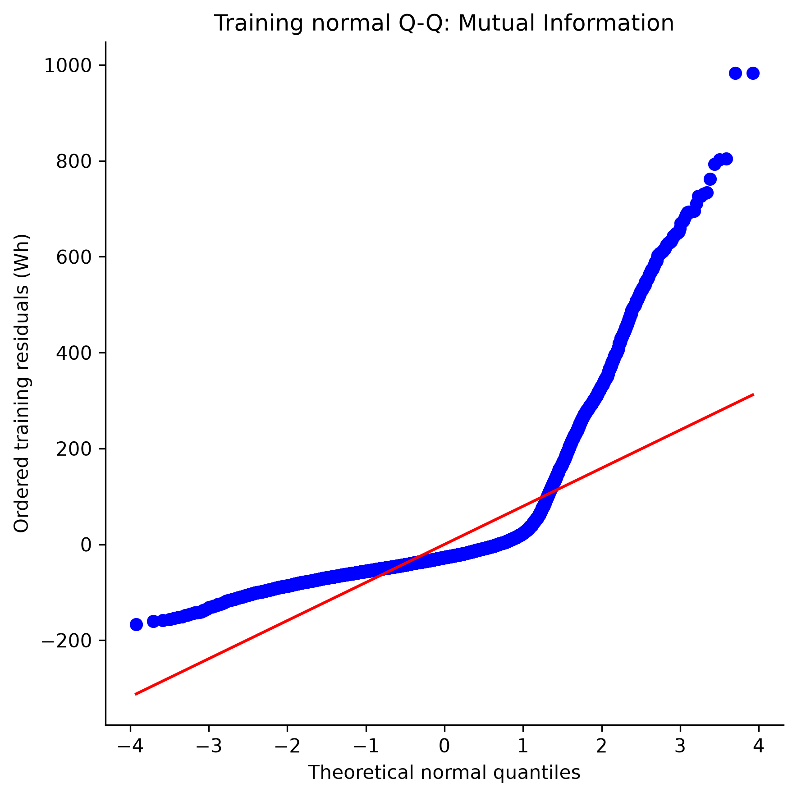

圖 22：家電能源，訓練殘差常態 Q-Q 圖；實際 FAST 產物，300 dpi。
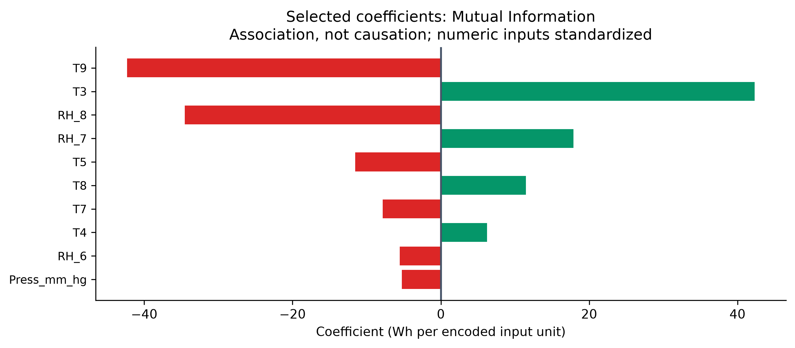

圖 23：家電能源，選定模型係數；實際 FAST 產物，300 dpi。
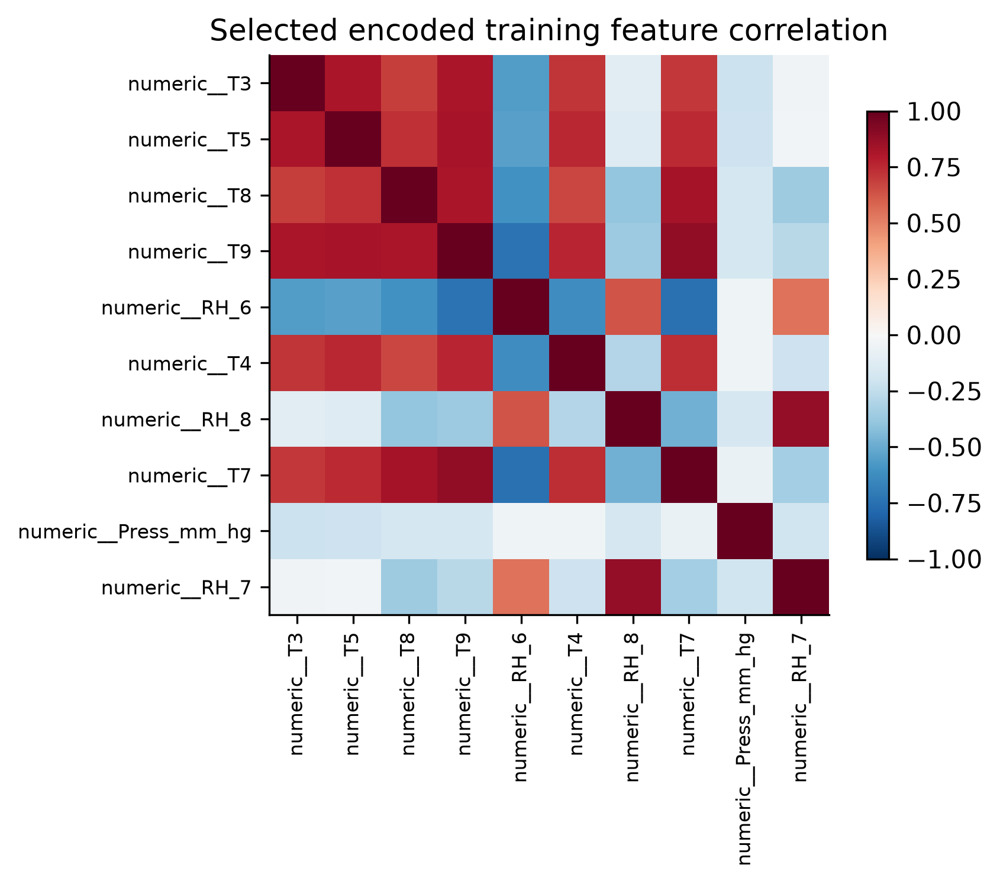

圖 24：家電能源，選定編碼特徵相關矩陣；實際 FAST 產物，300 dpi。
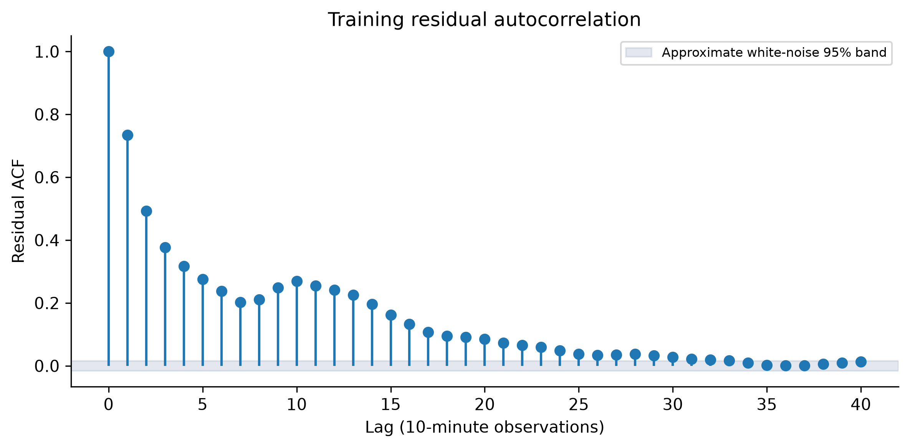

圖 25：家電能源，訓練殘差自相關；實際 FAST 產物，300 dpi。
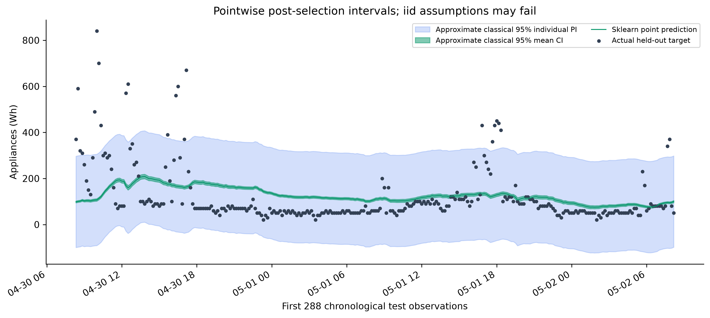

圖 26：家電能源，測試平均信賴區間與個別預測區間；實際 FAST 產物，300 dpi。

## 汽車價格：六階段 CRISP-DM

### 1. Business Understanding — 業務理解

以車輛規格與廠牌估計 price（USD），研究小樣本價格迴歸；這不是當前市場報價或因果效果。CarName 147 個原始名稱先作確定性廠牌擷取，22 個廠牌保留有意義資訊，避免車型名稱過度擬合。

### 2. Data Understanding — 資料理解

實際 205 筆、26 個 CSV 欄位、24 個原始輸入，包含 14 數值／10 類別。
目標範圍 5118.00–45400.00，平均 13276.7106，樣本標準差 7988.8523。
輸入缺失儲存格 0 個。沒有缺值也保留可重用的 fold-local imputer。

原始 CSV：car_ID, symboling, CarName, fueltype, aspiration, doornumber, carbody, drivewheel, enginelocation, wheelbase, carlength, carwidth, carheight, curbweight, enginetype, cylindernumber, enginesize, fuelsystem, boreratio, stroke, compressionratio, horsepower, peakrpm, citympg, highwaympg, price。

正式輸入：symboling, CarName, fueltype, aspiration, doornumber, carbody, drivewheel, enginelocation, wheelbase, carlength, carwidth, carheight, curbweight, enginetype, cylindernumber, enginesize, fuelsystem, boreratio, stroke, compressionratio, horsepower, peakrpm, citympg, highwaympg。

資料 SHA-256：2c78d99359a34cb6c64a97f276c1b6ea0532197b9b950b4521f65c0d9efcbc2b。

### 3. Data Preparation — 資料準備

排除 car_ID 與 price；24 個原始候選輸入全部保留，CarName 在 Pipeline 中轉為廠牌。seed=42，164/41 shuffled 80/20 holdout；inner/outer 均為 shuffled KFold。
數值中位數補值與 StandardScaler；學生名目類別使用眾數補值與 OneHotEncoder(handle_unknown="ignore")。
全部處理、排名與選擇放在完整 Pipeline，由每個 training fold 擬合，不能先全資料 fit 再 CV。
來源索引保留，能源不排序、不回填未來觀測；非法 schema、數值、目標或時間戳明確拒絕。

### 4. Modeling — 建模

Baseline 與五種方法最終都使用 LinearRegression。FAST 的 inner=2、outer=2。
內層選 k／alpha；外層評估完整訓練期選擇流程；全訓練部分再依 inner CV 固定正式方法，最後才評估 test。
推薦 **LASSO**，38 個 encoded 特徵，代表 14 個原始欄位；完整訓練編碼寬度 73。

選中特徵：numeric__wheelbase, numeric__carwidth, numeric__curbweight, numeric__enginesize, numeric__horsepower, numeric__peakrpm, categorical__CarName_alfa-romero, categorical__CarName_audi, categorical__CarName_bmw, categorical__CarName_buick, categorical__CarName_dodge, categorical__CarName_jaguar, categorical__CarName_mazda, categorical__CarName_mitsubishi, categorical__CarName_nissan, categorical__CarName_peugeot, categorical__CarName_plymouth, categorical__CarName_porsche, categorical__CarName_renault, categorical__CarName_saab, categorical__CarName_subaru, categorical__CarName_toyota, categorical__CarName_volvo, categorical__aspiration_std, categorical__carbody_convertible, categorical__carbody_hardtop, categorical__carbody_hatchback, categorical__carbody_wagon, categorical__drivewheel_fwd, categorical__enginelocation_front, categorical__enginetype_dohc, categorical__enginetype_l, categorical__enginetype_rotor, categorical__cylindernumber_eight, categorical__cylindernumber_four, categorical__cylindernumber_two, categorical__fuelsystem_mfi, categorical__fuelsystem_spdi。

Inner CV RMSE=3183.245439 ± 618.598052；
該方法 outer nested RMSE=3459.891496 ± 895.244109；
包含方法選擇的 workflow nested RMSE=3465.673276 ± 506.943514。
三者不是同一統計量；inner tuning score 不能冒充獨立泛化保證。

### 5. Evaluation — 評估

| 方法 | 資料 | encoded k | 有效 rank | MAE | MSE | RMSE | R² | Adjusted R² |
| --- | --- | --- | --- | --- | --- | --- | --- | --- |
| LASSO | train | 38 | 37 | 1021.6287 | 1970168.5901 | 1403.6269 | 0.9670 | 0.9576 |
| LASSO | test | 38 | 37 | 1965.8326 | 8235881.2133 | 2869.8225 | 0.8957 | -0.0433 |
| Correlation | train | 5 | 6 | 2339.8629 | 10771809.7978 | 3282.0435 | 0.8194 | 0.8137 |
| Correlation | test | 5 | 6 | 2781.2732 | 14565923.0405 | 3816.5329 | 0.8155 | 0.7891 |
| Mutual Information | train | 5 | 6 | 2373.1680 | 11253076.1756 | 3354.5605 | 0.8113 | 0.8053 |
| Mutual Information | test | 5 | 6 | 2766.5951 | 14528221.2691 | 3811.5904 | 0.8160 | 0.7897 |
| RFE | train | 5 | 6 | 1961.7489 | 6523036.5659 | 2554.0236 | 0.8906 | 0.8872 |
| RFE | test | 5 | 6 | 2363.7981 | 9570596.4326 | 3093.6381 | 0.8788 | 0.8614 |
| RFECV | train | 5 | 6 | 1961.7489 | 6523036.5659 | 2554.0236 | 0.8906 | 0.8872 |
| RFECV | test | 5 | 6 | 2363.7981 | 9570596.4326 | 3093.6381 | 0.8788 | 0.8614 |
| Baseline | train | 73 | 60 | 910.1326 | 1508602.6671 | 1228.2519 | 0.9747 | 0.9604 |
| Baseline | test | 73 | 60 | 1807.7040 | 7808716.0361 | 2794.4080 | 0.9011 | 不適用 |

Adjusted R² 使用 training affine design rank（含截距）；test 值只是描述性懲罰，不是重新擬合測試資料的推論。
自由度不足或常數目標時為空值。以下五項證據不代表因果，也不能自動宣稱假設全部成立。

#### linearity — Binned residual means vs fitted (descriptive)

以殘差對 fitted 與分箱平均檢查線性。殘差均值跨度 >0.5 個殘差 SD 只是宣告的視覺篩檢，不是顯著性檢定；未觸發不能證明線性。

實際統計：

    {"bin_count": 10, "minimum_bin_mean": -508.76401898554127, "maximum_bin_mean": 524.9352333854247, "bin_mean_span_residual_sd": 0.7364487115651164}

原始診斷解讀：Bin-mean residual span is 0.736 residual SD; inspect the plotted trend.

限制：A span >0.5 SD is a declared visual screening heuristic, not a significance test. A small span does not establish linearity.

#### independence — Durbin-Watson (source row order; descriptive only)

汽車原始行序不是時間；DW／ACF 只能作描述，不能證明觀測獨立。同廠牌或車型群組仍可能相依。

實際統計：

    {"durbin_watson": 1.7990301855497723, "ljung_box": [], "acf": [1.0, 0.0901502729847774, -0.09714475375219721, -0.07026352623861683, 0.02797550150442577, -0.13583688318034368, 0.022763932503927112, -0.05128914526708038, -0.14911489831658095, -0.0696473671586112, -0.018365021910089912, 0.06750040746066709, -0.10686667810484088, -0.02149576358770967, -0.006825316625664316, 0.036151923859314906, -0.023521494916753014, 0.032894667600749036, 0.00558493506465884, -0.07903900039116364, -0.048107564737946654, 0.09095824288205359, 0.1442624582602311, -0.08148340191006515, -0.16753851115107468, -0.011081074306431073, 0.08247608122579506, 0.021966735760934906, 0.0620825066587368, -0.10776527178055756, -0.031975404476023296, -0.004447083504364261, 0.05477448704148752, 0.024833870257010775, 0.06638648157809869, -0.03307252152601719, 0.10112519750364597, 0.0011274401767191588, -0.01743759107803347, 0.005541485909483912, 0.004506191558559995]}

原始診斷解讀：DW=1.7990; lag-1 ACF=0.0902.

限制：These observations have no justified temporal sampling order. DW cannot establish independence; group dependence remains possible.

#### homoscedasticity — Koenker-Breusch-Pagan on full-rank equivalent design

依下列真實 Koenker-Breusch-Pagan 統計判讀；選模及稀疏類別會限制 p 值解釋，未拒絕不等於證明等變異。

實際統計：

    {"lm_statistic": 82.49454289559853, "lm_pvalue": 1.647851655654421e-05, "f_statistic": 3.570588099914016, "f_pvalue": 6.757138873608154e-08, "auxiliary_df": 36}

原始診斷解讀：LM=82.4945, p=1.65e-05; evidence against constant variance.

限制：Rank-reduced auxiliary design includes an intercept. Nonrejection is not proof; temporal dependence and selection can invalidate nominal p-values.

#### normality — Shapiro-Wilk

實際常態性檢定拒絕常態。學生與汽車採 Shapiro-Wilk，能源大樣本採 Jarque-Bera；大樣本可對小偏離很敏感，必須同看 Q-Q、直方圖、偏態及尾部。

實際統計：

    {"test": "Shapiro-Wilk", "statistic": 0.9503690308276725, "pvalue": 1.533541573901201e-05, "pvalue_underflow": false, "n": 164, "skewness": 0.6446282282362026, "pearson_kurtosis": 5.822627605188888}

原始診斷解讀：p=1.53e-05, skew=0.645, kurtosis=5.823; normality rejected.

限制：Shapiro p-values are not used beyond 5000 observations. Large-sample tests detect small departures; fitted/selected and serially dependent residuals are not iid raw samples. Inspect histogram and Q-Q.

#### multicollinearity — Design rank, condition number and VIF (intercept excluded)

檢查含截距的 affine rank、VIF 與 condition。完整 one-hot 可造成 aliasing；個別不可識別係數不提供虛假的 SE/CI，不能只把原始特徵數當模型維度。

實際統計：

    {"rank": 37, "columns_with_intercept": 39, "condition_number": null, "effective_centered_condition": 46.36110039532919, "perfectly_collinear_columns": 4, "vif_above_10": 5}

原始診斷解讀：Design rank 37/39; 4 perfectly collinear columns; 5 finite VIF values above 10.

限制：VIF >10 is a screening convention, not a universal cutoff. Full one-hot sets create exact aliasing; null VIF plus status denotes infinity/undefined, not zero. Individual aliased coefficients are not unique.

#### 信賴區間、預測區間與實際殘差分析

條件平均 mean CI 描述 E[Y|X]；個別觀測 PI 加入殘差變異，通常更寬。
使用同一已選定 sklearn 模型的設計與係數順序，透過 centered SVD 的等價滿秩基底與 statsmodels OLS 計算 t 區間。
學生與汽車另有 HC3、能源有 HAC（24 lag）漸近 mean CI；robust mean CI 不是 robust individual PI。
超出訓練 affine span 時不輸出可識別區間；不強行反轉奇異矩陣。
沒有校正特徵／方法選擇不確定性，沒有證實 nominal coverage；不任意裁切負 Wh 或超過 0–20 的區間。

實際區間 metadata：

    {"level": 0.95, "training_rank": 37, "residual_df": 127, "classical_label": "Approximate post-selection OLS t mean CI / individual PI; iid homoscedastic normal-error working model", "robust_mean_covariance": "HC3", "hac_maxlags": null, "limitations": "Pointwise, conditional on selected features; excludes feature/method-selection uncertainty. Classical PI is not heteroscedasticity/autocorrelation-robust. Robust mean CI does not provide an individual PI or forecast guarantee. No clipping to physical target bounds.", "maximum_mean_prediction_difference": 4.547473508864641e-11, "robust_mean_status": "unavailable_high_leverage_or_nonfinite_covariance", "status": "partly_nonestimable_outside_training_affine_span", "nonestimable_rows": 1}

正式 training-CV 選定 LASSO（最終仍為 LinearRegression），Test RMSE=2869.8225 USD，R²=0.8957。只有 205 筆觀測，類別稀疏、品牌群組與未知類別限制外推；Baseline 的 test 較佳也不依 test 改選方法。

### 6. Deployment — 部署

既有靜態 DataLab 讀取 Python 真實產出的 schema-5 descriptor、係數、covariance、指標與殘差。
瀏覽器重現訓練補值、縮放、one-hot 和精確欄序，並逐筆與 Python 核對。
保留三題／方法／k 切換、預測、情境、CSV、深色與手機版；切題清除情境，不混合資料。
本機與 nested HTTP path 通過不等於公開 GitHub Pages 已更新；公開部署狀態以實際驗證為準。

### 本題實際圖表

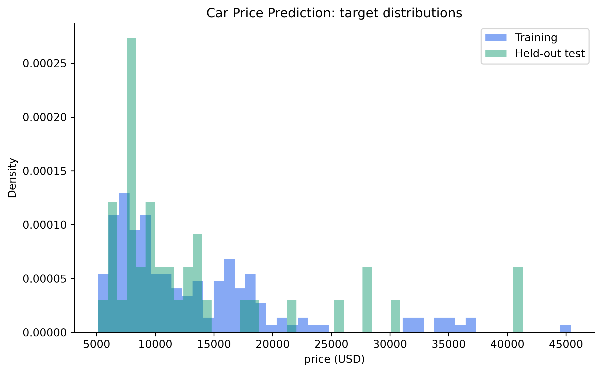

圖 27：汽車價格，訓練／測試目標分布；實際 FAST 產物，300 dpi。
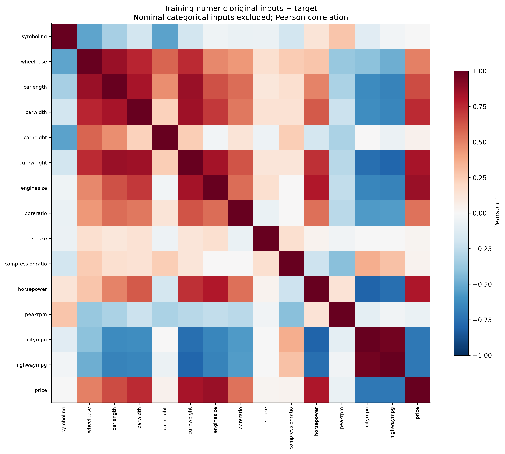

圖 28：汽車價格，訓練原始數值特徵相關矩陣；實際 FAST 產物，300 dpi。
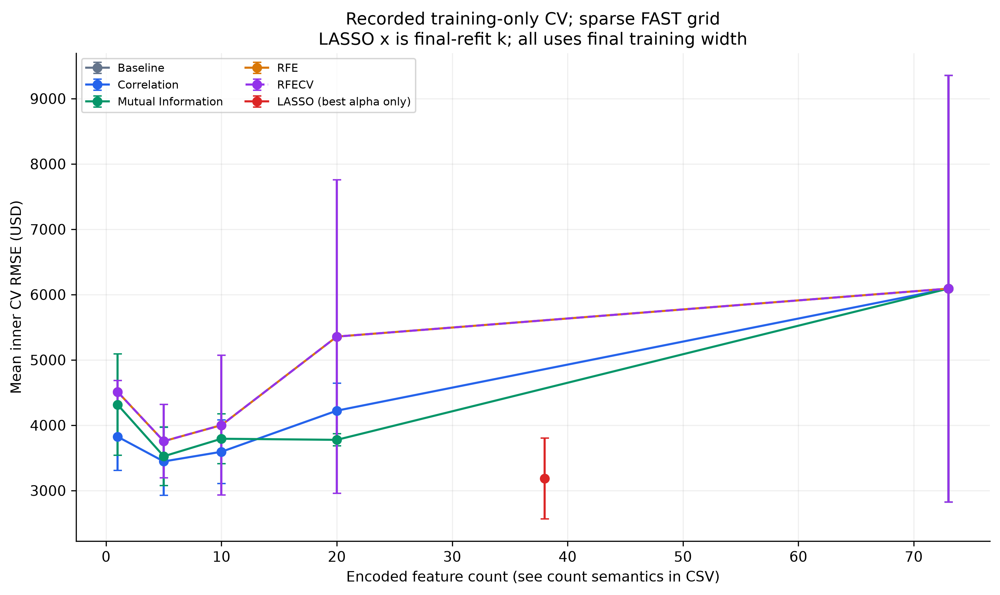

圖 29：汽車價格，特徵數與 inner CV RMSE；實際 FAST 產物，300 dpi。
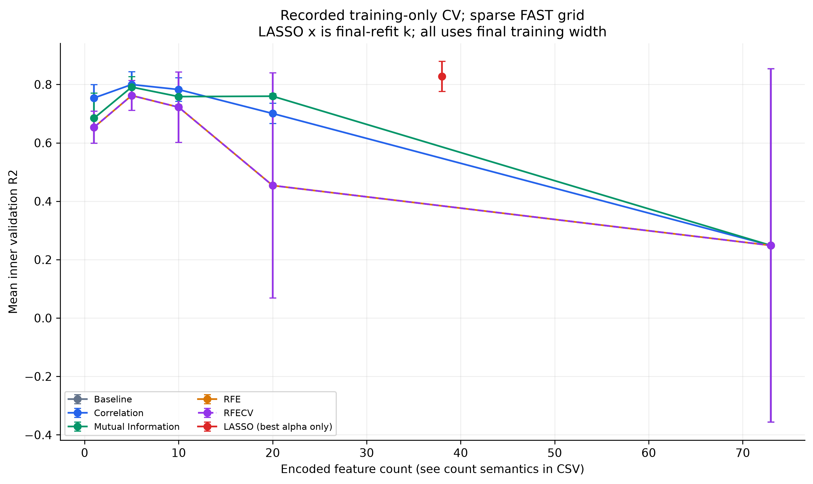

圖 30：汽車價格，特徵數與 inner validation R²；實際 FAST 產物，300 dpi。
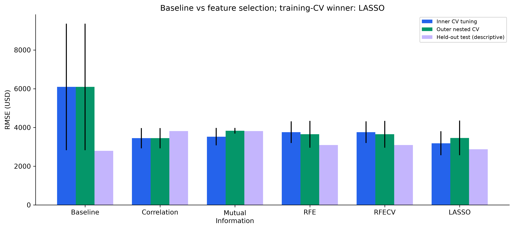

圖 31：汽車價格，Baseline 與特徵選擇 RMSE 比較；實際 FAST 產物，300 dpi。
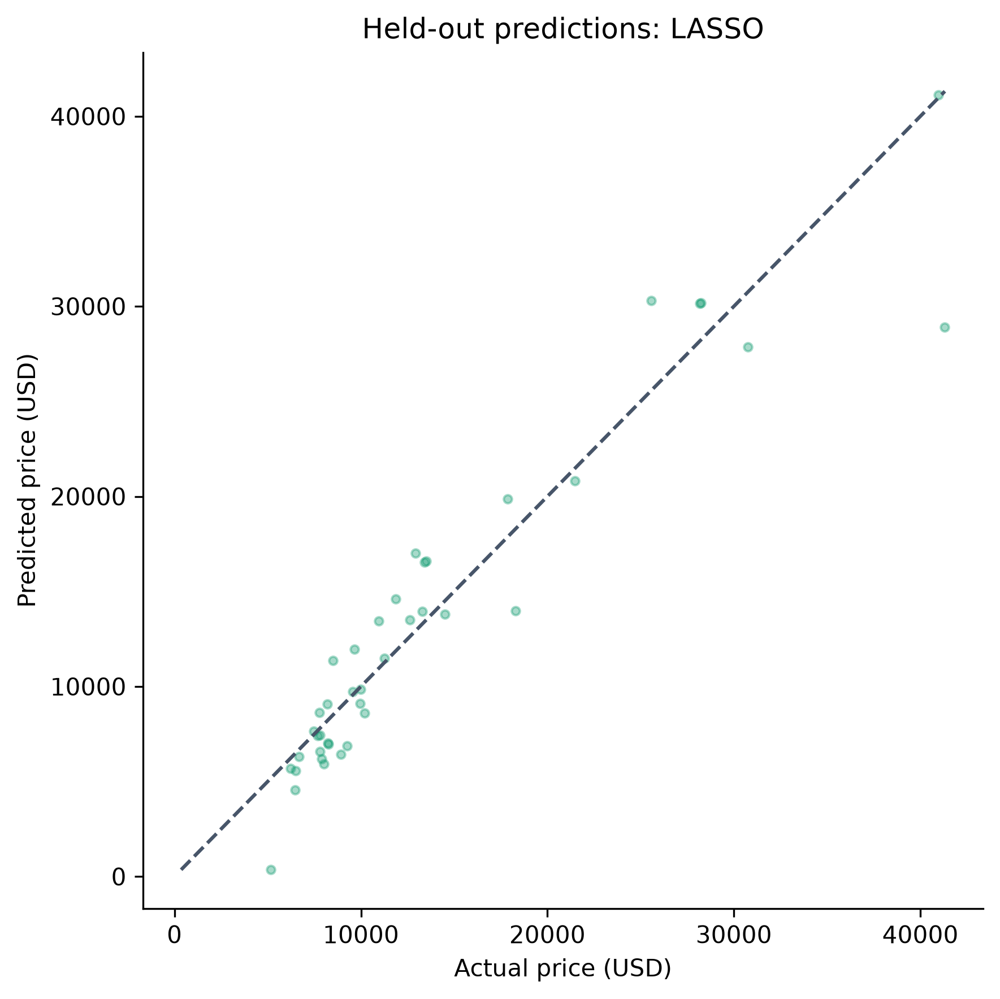

圖 32：汽車價格，測試實際值對預測值；實際 FAST 產物，300 dpi。
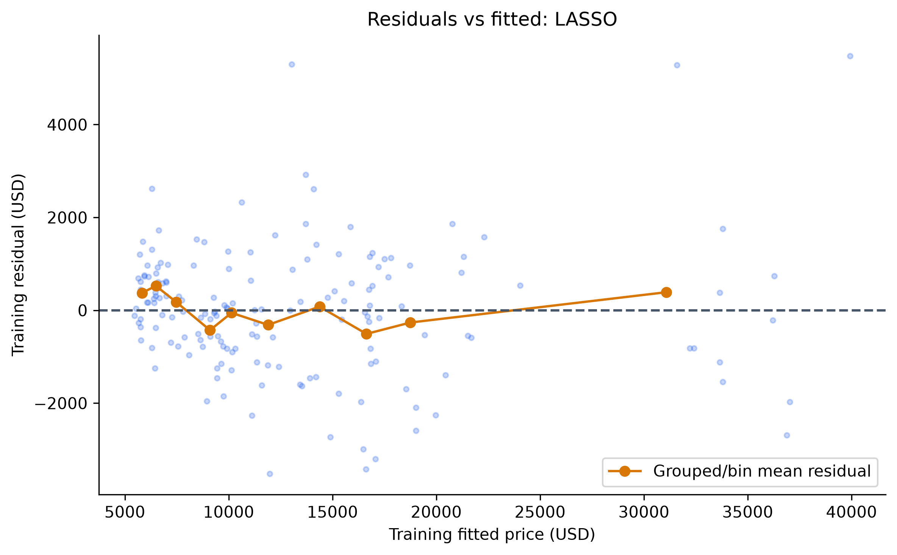

圖 33：汽車價格，訓練殘差對擬合值；實際 FAST 產物，300 dpi。
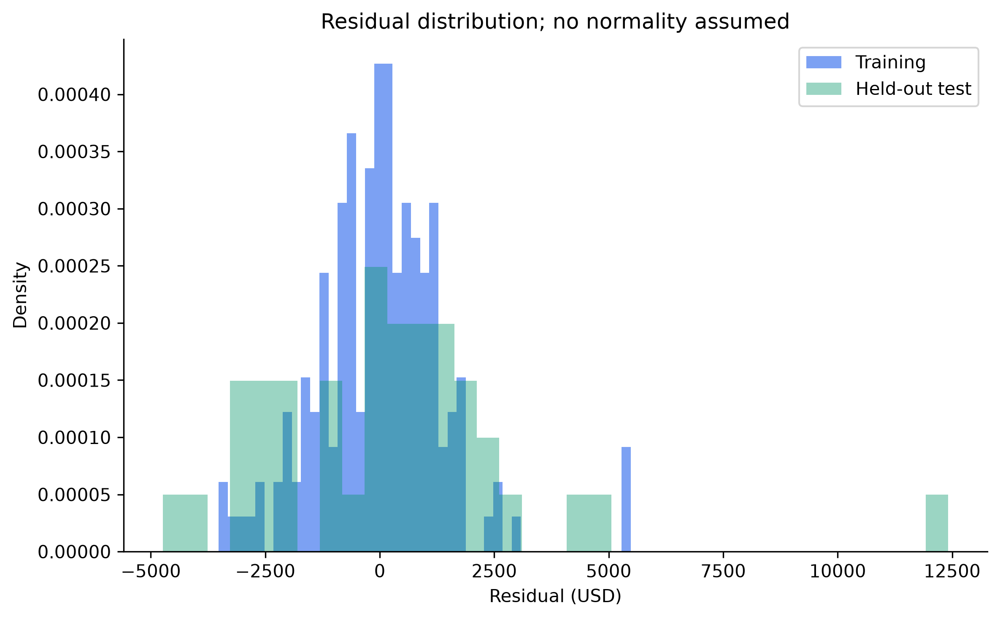

圖 34：汽車價格，訓練／測試殘差直方圖；實際 FAST 產物，300 dpi。
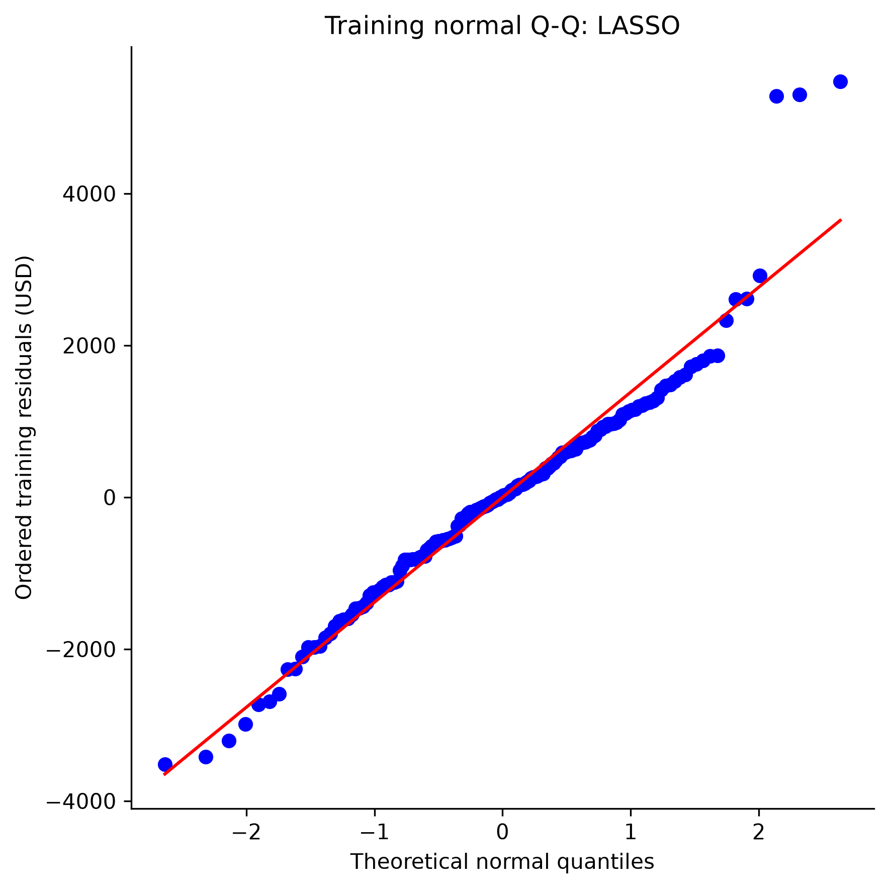

圖 35：汽車價格，訓練殘差常態 Q-Q 圖；實際 FAST 產物，300 dpi。
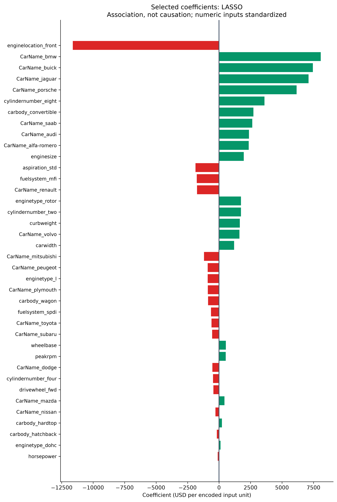

圖 36：汽車價格，選定模型係數；實際 FAST 產物，300 dpi。
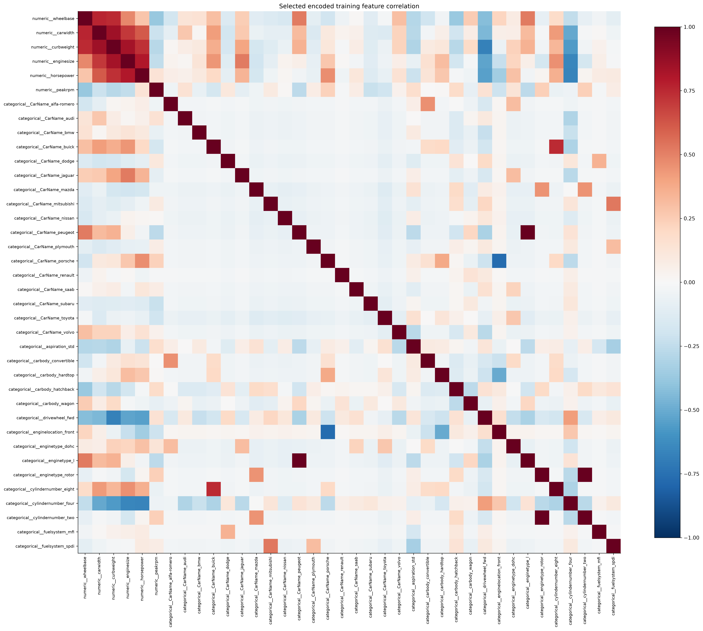

圖 37：汽車價格，選定編碼特徵相關矩陣；實際 FAST 產物，300 dpi。
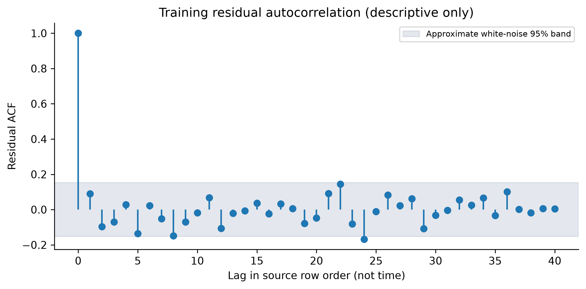

圖 38：汽車價格，訓練殘差自相關；實際 FAST 產物，300 dpi。
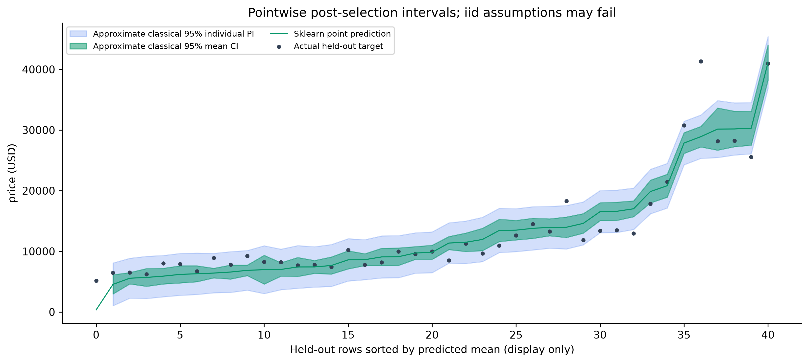

圖 39：汽車價格，測試平均信賴區間與個別預測區間；實際 FAST 產物，300 dpi。

## 三題比較、限制與改善

學生資料小、類別多、one-hot 與截距存在 aliasing，early-30 訊號有限，受切分與選擇不確定性影響；
能源雖大卻有序列相依與時段轉移，有效資訊量不等於獨立樣本數。三題 RMSE 不能跨單位直接比較。
後續先規劃 training-only FULL、能源時間 gap 敏感度與學生 group-aware 驗證；已觀察的 test 不應反覆用來調參。
非線性／不同誤差結構可作未來研究，本作業最終模型仍保留 LinearRegression。

## 結論

完成可追溯的三題線性迴歸、五種特徵選擇、完整診斷與互動介面。
保留負 R²、常態性違反、自相關等實際限制，不以測試資料重選方法，不宣稱傳統區間已校準或模型具有因果效果。

## AI 協助紀錄與待補附件

[AI_ASSISTANCE.md](AI_ASSISTANCE.md) 已收錄使用者提供的 NotebookLM 摘要；原始引用與使用日期、真實 ChatGPT 對話 PDF 及最終 PDF 匯出仍待補。
摘要屬研究對照，不把尚未實作的 RFE＋VIF、Random Forest 或 XGBoost 當作本專案結果。請補姓名／學號／課程與最終排版。

## **NotebookLM** 對同主題的解法進行研究

以下為**使用者提供的 NotebookLM 研究摘要原文**，保留其研究觀點；本環境未操作 NotebookLM 或取得摘要所依據的原始引用。此段不是本專案的實驗結果。

> 本研究基於 Kaggle 汽車價格預測與葡萄牙中學生學業表現數據集，探討多元線性迴歸（MLR）在迴歸預測問題中的應用實作與優化策略。資料前處理階段針對兩數據集中的人口統計、車輛規格及類別變數執行獨熱編碼（One-Hot Encoding）與資料清洗。特徵選擇方面，進階實作採用遞迴特徵消除（RFE）結合變異數膨脹因子（VIF）來消除多重共線性，提升模型係數之可解釋性；學生數據則針對前期成績（G1、G2）與最終成績（G3）的高相關性進行結構分析。模型評估採用 $R^2$、MAE 與 RMSE 等指標衡量預測誤差，並與隨機森林及 XGBoost 等非線性模型比對。相較於傳統直接擬合的線性迴歸，導入 RFE+VIF 機制能顯著改善變數共線問題；未來可進一步引入 Lasso/Ridge 正則化及非線性交互作用項，提升模型泛化能力與預測精準度。

- NotebookLM 實際使用日期：**［待填］**
- 上傳來源清單與逐項引用位置：**［待填］**
- 來源引用／人工核對結果：**［待填］**

後續來源核對可包含原始 UCI／Kaggle 資料說明、scikit-learn Pipeline／CV、statsmodels OLS／診斷文件，以及本專案真實 CSV 指標與圖表。不要把來源中的其他模型結果直接當成本專案結果。

## 圖表索引與驗收

[FIGURE_INDEX.md](FIGURE_INDEX.md) 列出全部 39 張真實 PNG 的圖號、檔名、用途與章節。
[最終驗收 JSON](phase5/validation.json) 記錄命令、測試數與 runtime；各 run hash 見 report_manifest.json。

## 參考文獻

1. [Student 原始資料／G1、G2 說明](https://archive.ics.uci.edu/dataset/320/student+performance)。
2. [指定 Student Kaggle](https://www.kaggle.com/datasets/larsen0966/student-performance-data-set)：實際提供 Portuguese。
3. [Appliances Kaggle](https://www.kaggle.com/datasets/loveall/appliances-energy-prediction)。
4. [Appliances 原始 UCI](https://archive.ics.uci.edu/dataset/374/appliances+energy+prediction)。
5. [scikit-learn Pipeline 與資料洩漏](https://scikit-learn.org/stable/common_pitfalls.html)。
6. [statsmodels OLS](https://www.statsmodels.org/stable/generated/statsmodels.regression.linear_model.OLS.html)。
7. [GitHub Pages 工作流程](https://docs.github.com/en/pages/getting-started-with-github-pages/using-custom-workflows-with-github-pages)。
9. [Car Price Kaggle](https://www.kaggle.com/datasets/hellbuoy/car-price-prediction)。
8. [專案原始碼](https://github.com/RayWu576/AIoT-HW2)。
